<p align="center">
  
</p>

<p align="center">
  <a href="https://github.com/taho140303/crop-asset-desktop/actions/workflows/ci.yml"></a>
  <a href="LICENSE"></a>
  
  
  
  
</p>

<p align="center"><strong>Crop AI-generated sprite sheets into game-ready animations</strong></p>

> **Project status:** Early development. Features and workflows are evolving; check the roadmap before relying on a particular capability.

## Table of contents

- [Why Sprite Cropper](#why-sprite-cropper)
- [Screenshots](#screenshots)
- [Features](#features)
- [Installation](#installation)
- [Usage](#usage)
- [Architecture](#architecture)
- [Tech Stack](#tech-stack)
- [Roadmap](#roadmap)
- [Contributing](#contributing)
- [License](#license)
- [Acknowledgments](#acknowledgments)

## Why Sprite Cropper

AI-generated sprite sheets often arrive with uneven spacing, inconsistent sprite sizes, and no reliable frame boundaries. Separating and preparing every frame by hand is tedious. Sprite Cropper helps game developers and artists automatically detect and crop sprites, normalize frames, and export usable animation assets.

## Screenshots

Workflow overview:

<p align="center">
  
</p>

- **Main UI** — Screenshot coming soon; placeholder only.
- **Auto-detect** — Screenshot coming soon; placeholder only.
- **Export dialog** — Screenshot coming soon; placeholder only.

See [`assets/screenshots/README.md`](assets/screenshots/README.md) to contribute real screenshots. Screenshots coming soon.

## Features

- 🔎 Detect sprites from image alpha channels and crop transparent margins automatically.
- ✂️ Manually resize, split, merge, and align selections.
- 📐 Normalize frame dimensions and set animation anchors.
- 👁️ Preview sequences with live onion-skin and timing controls.
- 📦 Export animation sequences, packed sprite sheets, and JSON metadata.
- 🖥️ Work across Windows, macOS, and Linux in a native desktop app.

## Installation

### Download prebuilt

When published, download an installer from the [GitHub Releases](https://github.com/taho140303/crop-asset-desktop/releases) page. Expected artifacts: Windows `.msi` or `_setup.exe`, macOS `.dmg`, and Linux `.deb` or `.AppImage`. No release packages are available yet.

### Build from source

Install Node.js `22.22.1`, pnpm 9+, Rust stable with Cargo, and platform-specific Tauri prerequisites (Linux: GTK 3, WebKitGTK 4.1, librsvg and build tools; macOS: Xcode Command Line Tools; Windows: Microsoft C++ Build Tools and WebView2). See the [Tauri prerequisites guide](https://v2.tauri.app/start/prerequisites/).

```bash
git clone git@github.com:taho140303/crop-asset-desktop.git
cd crop-asset-desktop
pnpm install
pnpm tauri dev
```

Use `pnpm dev` for the frontend-only Vite session or `pnpm build` for a production frontend build.

## Usage

1. Launch Sprite Cropper and open a sprite sheet.
2. Choose **Uniform Grid**, **Auto-Detect**, or **Manual** selection mode.
3. For Auto-Detect, adjust the alpha threshold and sprite gap, then select **Re-detect** to refresh regions.
4. Review, resize, split, merge, or align selections; convert detected regions to editable selections when needed.
5. Normalize to a target frame size and set the animation anchor.
6. Preview sequence order, timing, and onion-skin frames.
7. Choose an export folder, select **Both** for sprite sheet and JSON metadata, then export.

## Architecture

The React interface and canvas update Zustand state. Frontend requests cross the Tauri bridge to Rust filesystem commands, which read source assets and write exported sheets and metadata.

<p align="center">
  
</p>

## Tech Stack

| Area     | Technology                                        |
| -------- | ------------------------------------------------- |
| Frontend | React 19, TypeScript, Vite                        |
| State    | Zustand, Immer, zundo history                     |
| Canvas   | Konva, react-konva                                |
| UI       | Tailwind CSS, shadcn/ui patterns, Lucide          |
| Backend  | Tauri 2, Rust                                     |
| Format   | Sprite sheets, animation sequences, JSON metadata |

## Roadmap

- [x] Sprints 0–7: establish the application foundation, canvas, editing state, branding, and core workflows.
- [ ] Sprint 8: batch processing for multiple sprite sheets.
- [ ] Sprint 9: save and load editable project files.
- [ ] Next: a Chiikawa pet for DeepSeek Harness.

<p align="center">
  
</p>

## Contributing

Pull requests are welcome! Look for issues labeled **good first issue**. See the [contribution guide](CONTRIBUTING.md) for development setup and review expectations, read the [Code of Conduct](CODE_OF_CONDUCT.md), and report security issues according to [SECURITY.md](SECURITY.md).

## License

Distributed under the [MIT License](LICENSE). Copyright (c) 2026 taho140303.

## Acknowledgments

Thanks to the teams and communities behind [Tauri](https://tauri.app/), [React](https://react.dev/), [Konva](https://konvajs.org/), and [shadcn/ui](https://ui.shadcn.com/) for their tools and design patterns. Visual inspiration also comes from Chiikawa's cheerful little world.

---

<p align="center">If Sprite Cropper is useful to you, consider giving the project a star.</p>

<p align="center"><a href="https://star-history.com/#taho140303/crop-asset-desktop&Date"></a></p>
